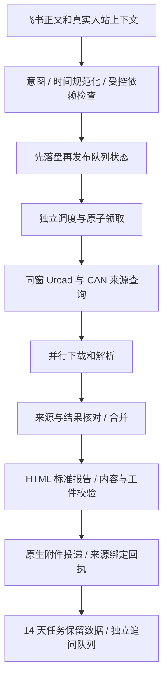

# 架构与边界

| 模块 | 职责 |
| --- | --- |
| `run_uroad_task.py` / `parse_time_input.py` | 真实来源与时间校验、依赖检查、持久化受理、服务唤起 |
| `task_registry.py` / `scheduler.py` / `task_worker.py` | 注册事务、领取令牌、跨进程锁、重型槽位与公平队列 |
| `cheyun_prod_client.py` / `cheyun_api_adapter.py` | 固定 Prod/Test 来源、完整分页和下载契约 |
| `parse_uroad.py` / `stream_can_signals.py` | Uroad 按来源、上下文、节点、时间索引关联；CAN 有界流式解析 |
| `parquet_can_stream.py` / `parquet_can_signals.py` | 冻结来源、有限下载重试、批量读 Parquet、任务内 SQLite 排序去重 |
| `run_uroad_pipeline.py` / `managed_subprocess.py` | 并行阶段、900 秒单步骤时限、所属进程树回收和诊断 |
| `build_html_report.py` / `validate_report_artifact.py` | 标准报告、内容完整性和可交付工件校验 |
| `delivery_bridge.py` | 精确来源会话、原生发送、附件 SHA/大小/来源回执和只补交付 |
| `followup_context.py` / `followup_answer.py` / `followup_agent.py` | 保留期、来源授权、同任务串行问答和完成登记 |
| `task_status.py` / `resume_uroad_task.py` / `retention_cleanup.py` | 只读查询、严格绑定恢复及独立保留期清理 |

业务内部 execution 与 delivery 独立：`completed` 表示标准报告已通过校验；`sent` 还须有正确来源、报告哈希、大小和原生确认构成的送达证据。不能以进程退出码或某一分支完成代替全链路完成。

每项任务仅使用 `outputs/uroad-report-runs/<job_id>/`。来源 message_id 重投才幂等；相同 VIN/时段的新来源是独立任务。默认两项重型任务、可用磁盘至少 20 GB；共享 Supervisor 部署以其全局串行策略为准，不叠加独立调度。
